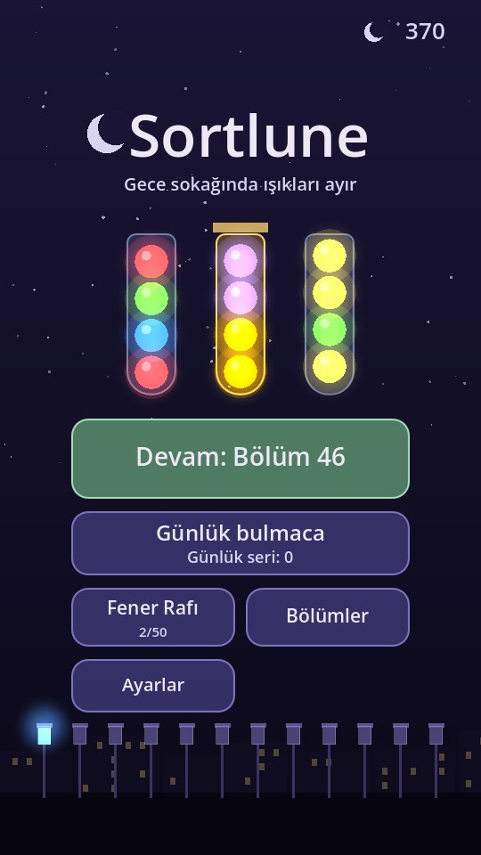
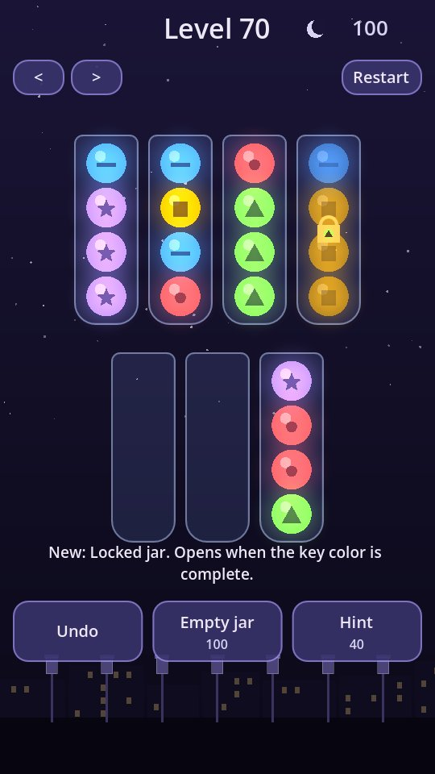
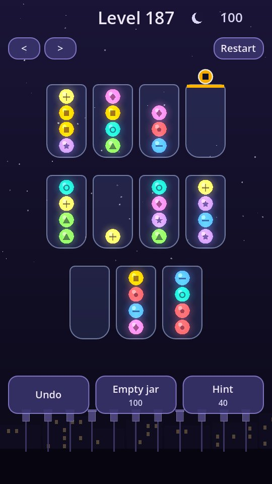
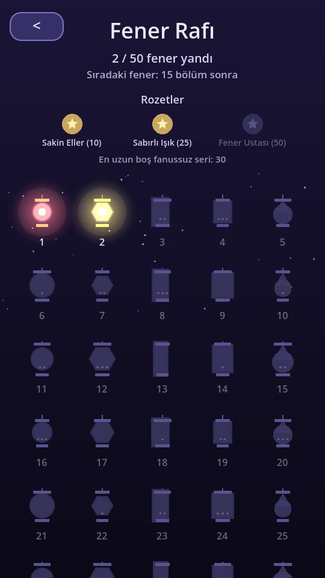

# Sortlune: Jar Sort Puzzle

A calm color-sorting puzzle for Android: pour colored tiles between jars until every jar holds a single color. Offline, no accounts, and every level is verified to be solvable.

[Türkçe](#türkçe) · [Privacy policy](privacy.md)

  
  
  
  

## Download

- **Android:** coming to Google Play.

## Features

- **Honest levels:** every level has a computer-checked shortest solution, so no level is a dead end. Hard levels are still hard.
- **Gentle start, steady climb:** short, easy levels first, then new twists one at a time: hidden tiles, locked jars, ice, rings and jars of different sizes. Each twist is announced one level before it appears.
- **Never stuck:** unlimited undo, restart, a free empty jar to earn, and a hint that shows the next step.
- **Endless path:** after the main levels, new levels keep coming, prepared in the background while you play.
- **Daily puzzle,** lanterns to collect, stars and a moonstone shelf. No timers, no lives.
- **Easy on the eyes:** soft colors with shape marks for color-blind players, reduced-motion and larger-text options, calm music.
- English and Turkish. Phone and tablet.

The game is free. It shows ads from Google AdMob, and the full-screen ads can be removed with a one-time purchase through Google Play; you can still choose to watch an optional ad to earn a hint or an extra jar.

## Support

luneapps.support@gmail.com

Built with Godot Engine (MIT license). Sound effects and music were generated in code for this game.

This repository holds the documentation only; the source code is not published here.

---

## Türkçe

# Sortlune: Jar Sort Puzzle

Android için sakin bir renk ayırma bulmacası: renkli taneleri fanuslar arasında dök, her fanusta tek renk kalsın. İnternetsiz, hesapsız ve her bölümün çözülebildiği doğrulanmıştır.

[Gizlilik politikası](privacy.md)

### Özellikler

- **Dürüst bölümler:** her bölümün bilgisayarla kanıtlanmış bir en kısa çözümü vardır, çıkmaz bölüm yok. Zor bölümler yine de zordur.
- **Yumuşak başlangıç, düzenli yükseliş:** önce kısa ve kolay bölümler, sonra yeni zorluklar tek tek: gizli taneler, kilitli fanuslar, buz, halkalar ve farklı boy fanuslar. Her yenilik görünmeden bir bölüm önce haber verilir.
- **Asla sıkışmazsın:** sınırsız geri al, yeniden başla, kazanılabilen boş fanus ve bir sonraki adımı gösteren ipucu.
- **Sonsuz yol:** ana bölümlerden sonra yeni bölümler gelmeye devam eder; sen oynarken arka planda hazırlanır.
- **Günlük bulmaca,** toplanacak fenerler, yıldızlar ve ay taşı rafı. Süre ve can yok.
- **Göze hoş:** renk körleri için şekil işaretli yumuşak renkler, hareketi azaltma ve büyük yazı seçenekleri, sakin müzik.
- Türkçe ve İngilizce. Telefon ve tablet.

Oyun ücretsizdir. Google AdMob reklamları gösterir; tam ekran reklamlar Google Play'den tek seferlik bir satın almayla kaldırılabilir, isteyen yine kısa bir reklam izleyip ipucu ya da ekstra fanus kazanabilir.

### Destek

luneapps.support@gmail.com
